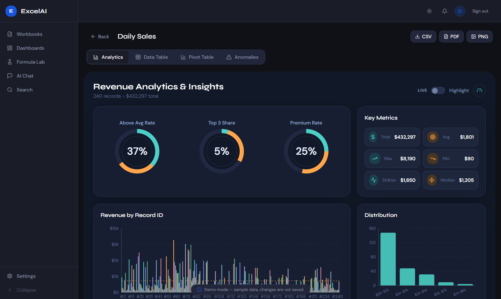
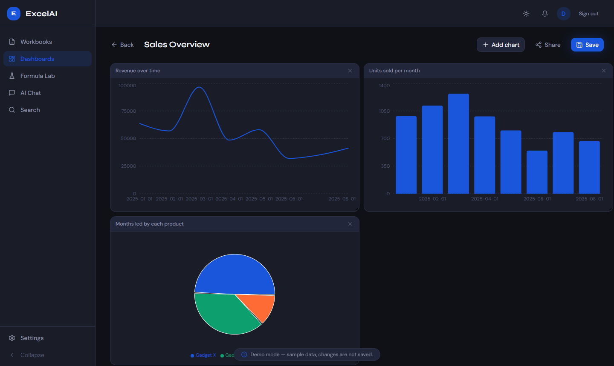
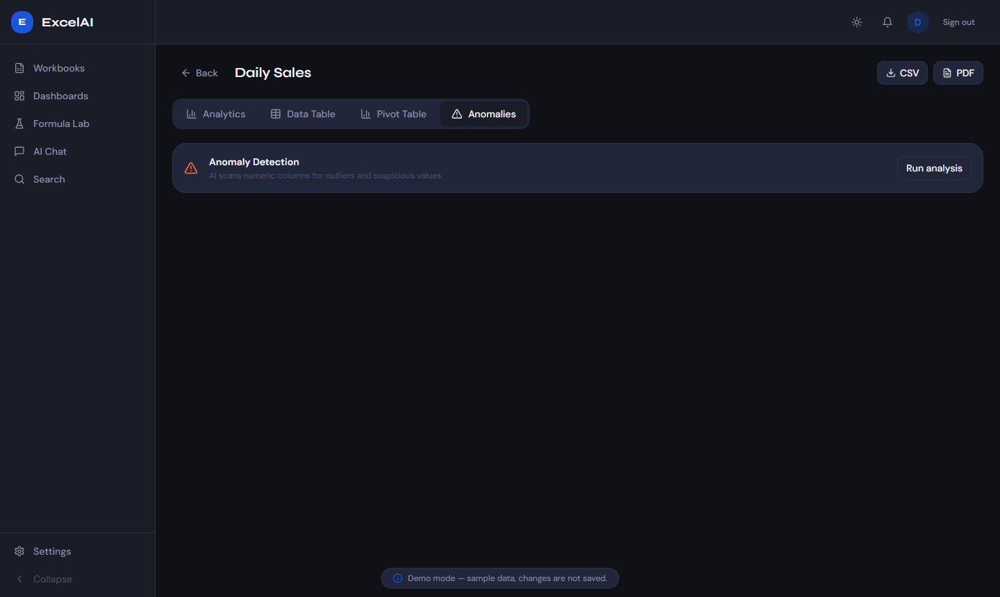
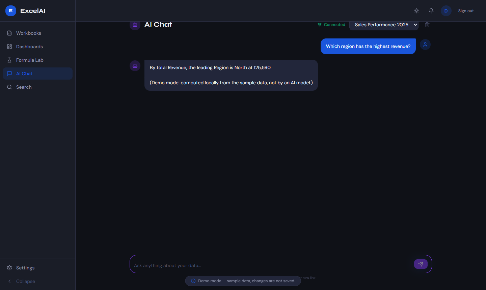
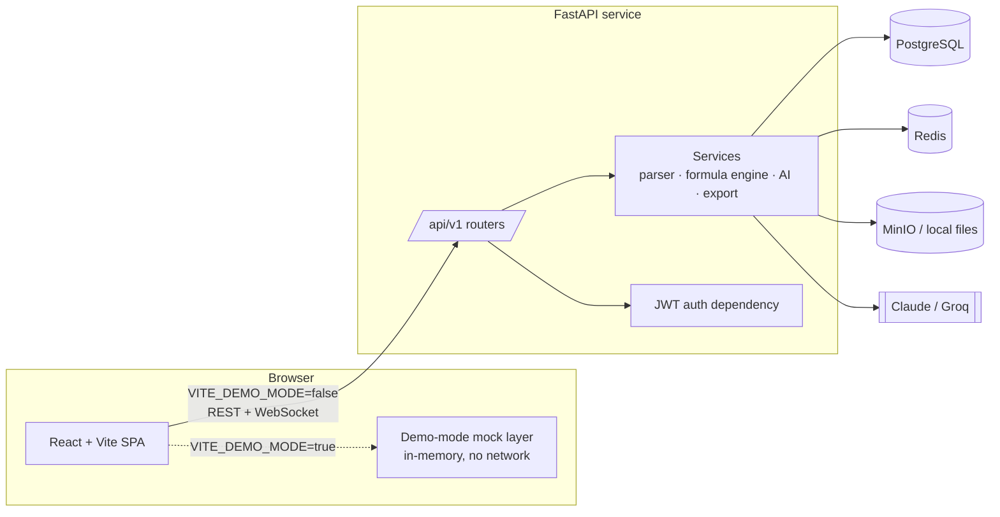

# ExcelAI Dashboard

> Upload an Excel or CSV workbook and get instant analytics, auto-generated charts, anomaly detection, an Excel formula engine and an AI data assistant — backed by an async **FastAPI** REST API.

[](https://github.com/mungaiDaniel/exel-AI/actions/workflows/ci.yml)

**🔗 Live demo:** _<add your Vercel URL here>_ &nbsp;·&nbsp; click **Try Demo** — no sign-up needed.

<p align="center">
  
  
</p>
<p align="center">
  
  
</p>

> **About the live demo.** The hosted demo is a **frontend-only build running on in-browser mock data** (`VITE_DEMO_MODE=true`). It has no server: every API call is answered from memory, so creating, editing and deleting things feels real during your session, but nothing is saved and AI answers are canned. The real FastAPI backend in this repo runs locally (see [Local setup](#local-setup)) and is what the test suite exercises.

---

## Features

- **Workbook ingestion** – upload `.xlsx`, `.xls`, `.xlsm` or `.csv` (up to 50 MB); multi-sheet parsing with automatic column-type detection (number, currency, datetime, text).
- **Query API** – paginated sheet data plus a filterable query endpoint (`col`, `col_like`, `col_in`, `col_gt/gte/lt/lte`, full-text `q`, sorting).
- **Auto-analytics** – chart suggestions based on column types, z-score **anomaly detection**, pivot tables, CSV and PDF export.
- **Dashboard builder** – drag-and-drop grid layout, persisted per user, with revocable public share links.
- **Formula engine** – a hand-written, `eval`-free evaluator for 40+ Excel functions (math, logic, lookup, text, date, statistics, finance).
- **AI assistant** – chat grounded in your workbook's data with streaming over WebSocket; Anthropic Claude or Groq selectable by config. Optional: the app works without an API key.
- **Auth** – JWT access/refresh tokens, bcrypt password hashing, per-user data isolation on every resource.
- **Demo Mode** – the whole UI runs with no backend on clearly fake sample data.

## Tech stack

**Backend**
- Python 3.12, **FastAPI**, Pydantic v2 / pydantic-settings
- SQLAlchemy 2.0 (async) + asyncpg, **PostgreSQL**, Alembic migrations
- PyJWT + bcrypt for auth
- pandas / openpyxl for parsing, ReportLab for PDF export
- Redis (cache) + Celery (workers), MinIO or local disk for file storage
- Anthropic / Groq SDKs for the AI features
- pytest, pytest-asyncio, pytest-cov, httpx, ruff, GitHub Actions CI, Docker Compose

**Frontend**
- React 18, TypeScript, Vite, Tailwind CSS
- Zustand, Axios, TanStack Table, Recharts, react-grid-layout
- Vitest (demo/mock layer tests)

## Architecture



**Backend layout** (`backend/app`)

| Path | Responsibility |
|---|---|
| `api/v1/*.py` | Thin routers: validate input, enforce ownership, call services |
| `api/deps.py` | `get_current_user` – verifies a Bearer **access** token |
| `core/` | Settings (fail-fast on weak secrets), async DB engine, JWT/bcrypt helpers, error types |
| `models/`, `schemas/` | SQLAlchemy ORM models / Pydantic request & response models |
| `services/` | Business logic: Excel parser, formula engine, chart advisor, anomaly detector, exporters, storage, LLM clients |
| `workers/` | Celery app and background tasks |

**Frontend ↔ backend.** All HTTP goes through one Axios instance (`frontend/src/api/client.ts`) that adds the Bearer token and refreshes it on a 401. Chat streams over a WebSocket (`/api/v1/chat/ws/{workbook_id}`). In demo mode the Axios `adapter` and the WebSocket are replaced by the mock layer in `frontend/src/demo/`; with the flag off none of that code is loaded.

**Design notes**
- Every resource is scoped to its owner; cross-tenant access returns `404` (not `403`) so IDs can't be probed. This is covered by tests.
- Access and refresh tokens carry a `type` claim, so a refresh token can't be used as an access token (and vice-versa).
- Errors are returned as `{"detail": ...}`; validation failures as `422` with per-field messages; unexpected errors are logged and returned as a generic `500` without internals.
- `JWT_SECRET_KEY` must be strong when `DEBUG=false` – the app refuses to start otherwise.

## API endpoints

Base path `/api/v1`. Interactive docs at `/api/docs` (Swagger) and `/api/redoc`.

| Method | Route | Description | Auth |
|---|---|---|---|
| GET | `/health` *(no prefix)* | Liveness check | – |
| POST | `/auth/register` | Create account, returns token pair | – |
| POST | `/auth/login` | Log in, returns token pair | – |
| POST | `/auth/refresh` | Exchange a refresh token for a new pair | – (refresh token) |
| GET | `/auth/me` | Current user | ✅ |
| GET | `/workbooks` | List my workbooks | ✅ |
| POST | `/workbooks/upload` | Upload & parse an Excel/CSV file | ✅ |
| GET | `/workbooks/{id}` | Workbook details | ✅ |
| DELETE | `/workbooks/{id}` | Delete workbook and its file | ✅ |
| GET | `/workbooks/{id}/sheets` | List a workbook's sheets | ✅ |
| GET | `/sheets/{id}` | Sheet metadata and column types | ✅ |
| GET | `/sheets/{id}/data` | Paginated rows (`page`, `page_size` ≤ 1000) | ✅ |
| GET | `/sheets/{id}/query` | Filter / sort / search rows | ✅ |
| POST | `/charts/suggest` | Suggest charts for a sheet | ✅ |
| GET | `/anomalies/{sheet_id}` | Z-score outliers (+ optional AI explanation) | ✅ |
| POST | `/formulas/evaluate` | Evaluate an Excel formula | ✅ |
| POST | `/formulas/explain` | Plain-English explanation (needs AI key) | ✅ |
| GET | `/formulas/history` | My recent evaluations | ✅ |
| GET | `/dashboards` | List my dashboards | ✅ |
| POST | `/dashboards` | Create a dashboard | ✅ |
| GET | `/dashboards/{id}` | Get a dashboard | ✅ |
| PUT | `/dashboards/{id}` | Update name / layout / visibility | ✅ |
| DELETE | `/dashboards/{id}` | Delete a dashboard | ✅ |
| POST | `/dashboards/{id}/share` | Create a public share link | ✅ |
| DELETE | `/dashboards/{id}/share` | Revoke the share link | ✅ |
| GET | `/dashboards/shared/{token}` | Read a shared dashboard | – |
| POST | `/export/csv/{sheet_id}` | Download sheet as CSV | ✅ |
| POST | `/export/pdf/{sheet_id}` | Download sheet as PDF | ✅ |
| POST | `/chat/message` | Ask the AI about a workbook | ✅ |
| GET | `/chat/history/{workbook_id}` | Chat history | ✅ |
| WS | `/chat/ws/{workbook_id}?token=` | Streaming chat | ✅ (access token) |
| GET | `/search?q=` | Search workbooks, sheets, columns and cell data | ✅ |

## Local setup

### Prerequisites
Python 3.12+, Node 20+, Yarn 1.x. PostgreSQL 16 is needed to run the API (not for the tests). Redis/MinIO are optional (`STORAGE_BACKEND=local` is the default).

### 1. Backend

```bash
cd backend
python -m venv .venv && source .venv/bin/activate      # Windows: .venv\Scripts\activate
pip install -r requirements-dev.txt

cp ../.env.example ../.env     # then edit: DB password, JWT_SECRET_KEY, optional AI keys
```

Create the database and run migrations:

```bash
createdb excelai_db            # or any Postgres you like; match DATABASE_URLs in .env
alembic upgrade head
uvicorn app.main:app --reload  # http://localhost:8000/api/docs
```

> With `DEBUG=true` the app also auto-creates tables on startup, which is handy for a first run. Use Alembic everywhere else.

**Environment variables** (see [`.env.example`](.env.example) for the full list)

| Variable | Purpose |
|---|---|
| `DEBUG` | `true` = dev mode (verbose logs, auto-create tables, allows weak secrets) |
| `JWT_SECRET_KEY` | **Required** (≥ 32 chars) when `DEBUG=false`. `python -c "import secrets; print(secrets.token_urlsafe(48))"` |
| `ASYNC_DATABASE_URL` / `DATABASE_URL` | Postgres connection strings (asyncpg / sync for Alembic tools) |
| `CORS_ORIGINS` | JSON list of allowed browser origins |
| `STORAGE_BACKEND` | `local` (default, `./uploads`) or `minio` |
| `AI_PROVIDER`, `ANTHROPIC_API_KEY`, `GROQ_API_KEY` | Optional. Without a key, AI endpoints return `503` and everything else works |

### 2. Frontend

```bash
cd frontend
yarn install
yarn dev                       # http://localhost:5173, proxies /api to localhost:8000
```

Try it without any backend:

```bash
VITE_DEMO_MODE=true yarn dev   # PowerShell: $env:VITE_DEMO_MODE="true"; yarn dev
```

### 3. Everything with Docker Compose

```bash
cp .env.example .env           # set POSTGRES_PASSWORD, MINIO_SECRET_KEY, JWT_SECRET_KEY
docker compose up --build
docker compose exec backend alembic upgrade head
```

### Running the tests

```bash
cd backend
pytest                         # 78 tests, ~70% coverage, runs on in-memory SQLite — no services needed
ruff check .                   # lint

cd ../frontend
yarn test                      # vitest: demo/mock layer
yarn build                     # type-check + production build
```

The backend suite covers auth (including expired/forged/wrong-type tokens), every resource's CRUD, ownership isolation between users, validation errors, file upload rules, exports, the formula engine and the chat endpoint (with the LLM stubbed).

## Deploying the demo (Vercel)

The frontend is a static SPA and `frontend/vercel.json` already sets `VITE_DEMO_MODE=true` and the SPA rewrite.

1. Push this repo to GitHub.
2. In Vercel: **Add New → Project → import the repo**.
3. Set **Root Directory** to `frontend`. Framework preset (Vite), install and build commands are picked up from `vercel.json`.
4. Deploy, then paste the URL into the *Live demo* line at the top of this README.

CLI alternative: `cd frontend && npx vercel --prod`.

## Project status & notes

- Demo-mode data is synthetic (no real people, companies, emails or phone numbers).
- Known follow-ups: upgrade React Router to v7 and Vite to v6 (both major bumps, left out on purpose), add rate limiting on the auth routes, and token revocation on logout.
- The original product blueprint lives in [`docs/BLUEPRINT.md`](docs/BLUEPRINT.md).

## Author

**Daniel Mungai**
- GitHub: [github.com/mungaiDaniel](https://github.com/mungaiDaniel)
- LinkedIn: [linkedin.com/in/daniel-mungai-7a52451b8](https://linkedin.com/in/daniel-mungai-7a52451b8)

## License

[MIT](LICENSE)
